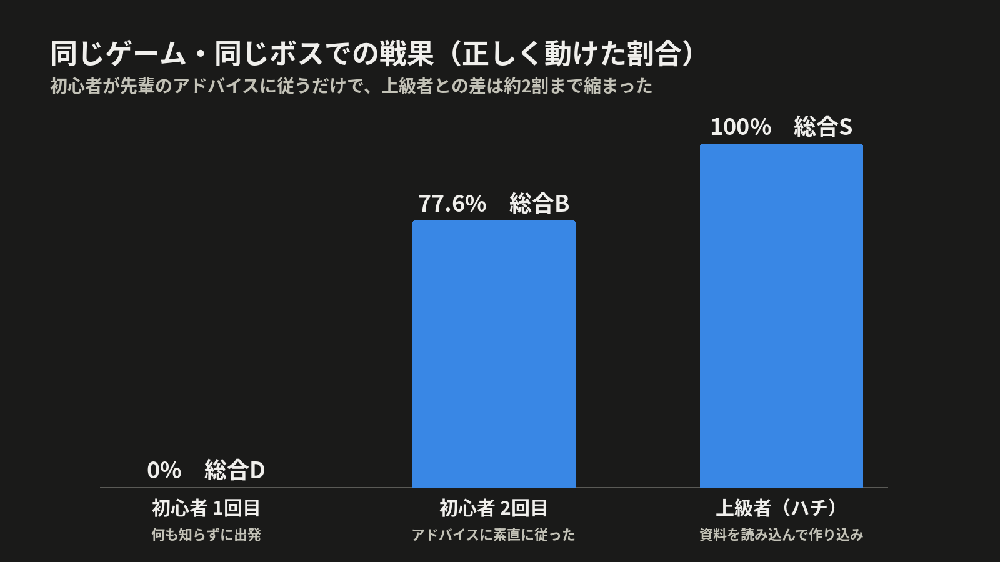

# LT素材: Claudeに「AI初心者のふり」をしてゲームを遊んでもらった

> 社内技術共有会LT用の追加素材（「Claude in Chrome に『自分の作ったゲーム』を遊ばせてみた」の続き）
> 作成: 2026-11-04 / 出典: このセッションの会話と、Claudeが残した日時付きの操作メモ
> 時刻はClaudeが記録した実時刻（JST）。

---

## 0. 一言でいうと

- **「AIエージェントを知らない初心者になりきって遊んで」と頼んだら、Claudeがわざと初心者らしく失敗し（戦果0%）、先輩のアドバイスに素直に従って77.6%まで上げ、その差から「ゲームが初心者をどう導けているか」を評価してきた。**
- 前回は「上級者として攻略する」テスト。今回は**「狙ったユーザー像を演じて体験を評価する」**テスト。同じClaudeに、プレイヤー像を指定して遊ばせ分けられる。
- 操作は前回と同じく Claude in Chrome（私のMacのChromeを実際にクリック・入力）。
- かかった時間は、依頼から報告まで**約11分**（22:33〜22:44）。出発2回・講評2回・先輩のアドバイス込み。

## 1. 依頼したこと（原文そのまま）

> では次は、AIエージェントとかまったく知らない、AI初心者になったつもりでプレイしてください。別画面を開けば新しいキャラが作れると思います。キャラクターは猫の他の種類を使ってください。初心者っぽくふるまった点と、それがどう評価されたかを相対的に把握した上で、フィードバック（良い点・悪い点）をお願いします。

直前に、同じClaudeが上級者として組んだハチワレの冒険者「双色の剣客ハチ」が**戦果100%・総合S**をとっている。今回はそれとの比較になる。

## 2. 何をしたか

| 時刻 | Claudeの行動 | ねらい |
| --- | --- | --- |
| 22:34 | 新しいタブでも前のアカウントのままだったので、ログアウトして新アカウント「みけ初心者」を作成 | 別人として始める |
| 22:35 | 説明はほぼ読まずに登録。**三毛猫**・武器は**フライパン**・名前「みけまる」 | 見た目重視の初心者 |
| 22:35 | 心得は「あなたは強い冒険者です。伯爵を倒して。にんにくが効くので使って。がんばってね！」の100字だけ | AIへの指示の書き方を知らない |
| 22:35 | 道具は名前の印象で**にんにく・聖剣・お守り**（実はすべてダミー）。巻物・結界・お供は意味が分からず触らない | 「強そう」「効きそう」で選ぶ |
| 22:36 | 先輩に「まだ早い」と言われても、**とりあえず出発** | よくある初心者の行動 |
| 22:38 | 0%を見て、先輩の「詳しいアドバイス」をもらい、**素直に従って直す** | 助言だけで伸びるかを見る |
| 22:38〜41 | 心得は図鑑の技名を1行ずつ写すだけ。巻物は資料3本を**丸ごとコピー**（虫食いの写本もそのまま）。結界は報告の台詞を**丸ごと**入れ、12文字制限に引っかかって短く切る。お供は**テンプレートのまま** | 自分では工夫しない |
| 22:41 | 2回目の出発 | |

## 3. 結果

| | 初心者1回目 | 初心者2回目 | 上級者（ハチ） |
| --- | ---: | ---: | ---: |
| 戦果 | **0%** | **77.6%** | **100%** |
| 総合評価 | D「古城に迷いこんだ駆け出し」 | B「古城の頼れる中堅」 | S「伯爵を討ち果たした英雄」 |
| 心得 | 0/12 | 8/12 | 12/12 |
| 道具 | 0/1 | 1/1 | 1/1 |
| お供 | 0/3 | **3/3**（テンプレートのまま） | 3/3 |
| 冒険日誌 | 0/1 | 0/1 | 1/1 |
| 巻物 | 0/5 | 4/5（虫食いの呪文で失敗） | 5/5 |
| 結界 | 0/3 | 3/3 | 3/3 |

**読み取れること**
- 初心者でも、**先輩のアドバイスに素直に従えば1回で0%→77.6%（D→B）**まで上がる。
- 残り約2割の差は、資料を読み込まないと分からない工夫（攻撃が同時に来たときの優先、見せかけ、割れた盾、虫食いの復元）だった。**入口はやさしく、上は深い**という難しさの段差になっている。

## 4. Claudeが出したフィードバック

**良い点**
1. 先輩冒険者のアドバイスが、答えを教えずに次の一手を示してくれる（「どうやって思い出させる？」と問いかける形）。
2. 0%でも講評の語り口がやさしい（「まずは焦らずにいこう」）。ダミー道具も責めずに気づかせる（「ロマン枠もありだがな」）。
3. 結界の「12文字まで」の制限で、「長い言葉はすり抜ける」という教えに自然に気づける。
4. お供はテンプレートのままでも満点で、サブエージェントの効き目を体験しやすい。
5. 巻物の失敗には「資料と見比べてみよう」とだけ言う。ネタバレせずにヒントになっている。

**悪い点・改善点**
1. **【重要】講評の指摘が事実と違う。** 「日誌を読み返さずに外した」とあったが、記録では読んでいた。本当の原因は技を知らなかったこと。初心者はこれを信じて迷う。
2. 先輩の簡易チェックが質を見ていない。初心者の2回目にも、満点だった上級者と同じ「出発してよし」が出る。
3. 先輩に「まだ早い」と言われても、そのまま出発できる。出発の確認画面が先輩の判定に触れない。
4. 冒険の記録に、答えが「garlic」「excalipar」と内部名のまま出る。
5. 詳しいアドバイスが、ダミー道具を「いつ使うかがあいまい」としか言わず、役に立たないことに気づけない。
6. 画面上の不具合（2回再現）：ねこの柄を選んだ直後に名前を打つと別の欄に入る。道具のチェックを付け外しすると位置がずれて、押したつもりが反映されない。
7. 別タブでもログインが共通で、ログアウトしないと別のキャラを作れない。

## 5. LTでの見せ方（案）

- 主張: **「ペルソナを指定するだけで、ユーザーテストの役者になってくれる」**。上級者と初心者を同じClaudeに演じ分けさせると、「難しすぎないか」「助言は効いているか」を数字で比べられる。
- 見せる画像（このmdと同じフォルダ）
  - `lt-images-beginner/06_score_chart.png` … 0% → 77.6% → 100% の比較（スライド1枚）
  - `lt-images-beginner/00_storyboard.png` … 「先輩『まだ早い』→ 心得を書き直す → 『出発してよし』→ 講評B → 2位」の4コマ
  - `lt-images-beginner/01_prompt_rewrite.png` 〜 `05_ranking.png` … 要所の静止画
  - `/Volumes/D/Download/agent_guild_2026-11-04_beginner_mike.gif` … 操作の録画（約63秒・50コマ）
- 話の流れ（約60秒）
  1. 依頼文を見せる（「初心者になったつもりで」）
  2. わざと「にんにく・聖剣・がんばって！」で出発 → 0%（笑いどころ）
  3. 先輩の助言に従っただけで77.6%（グラフ）
  4. オチ: Claudeが「講評のこの指摘は事実と違う」とゲームのバグまで見つけてきた

## 6. 注意・補足

- 録画GIFは最後の50コマだけが残る仕組みで、**2回目の手直しから戦果までの部分**が映っている。1回目の0%の場面は入っていない。
- 初心者の役は、Claudeが「初心者ならこうするだろう」と考えて演じたもの。本物の初心者による検証の代わりではないので、試運転で実際の参加者の声と見比べるのがよい。
- 2回目の巻物の中身と結界の言葉は、資料のコピーを直接入力しているので、GIFには入力の様子が映っていない。
- 【要確認】GIFと静止画には資料の内容が小さく映るコマがある。参加予定者に見せる場合は確認を。
